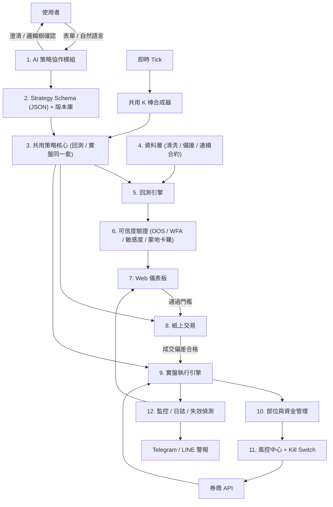
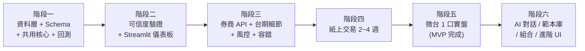

# AI 自然語言驅動自動下單與回測系統規劃書(v3)

> **v3 更新重點**
> - 新增「策略格式規格 (Strategy Schema)」:AI 與引擎之間的唯一介面。
> - 新增「回測與實盤 K 棒一致性」、「台灣期貨下單細節」、「歷史資料來源」。
> - 新增「市面同類軟體功能對照」,並挑選值得納入的功能。
> - 新增「MVP 範圍定義」、「測試策略」、「成本估算」、「資料備份」。
> - 路線圖改以 MVP 為主軸,進階功能延後。
>
> v2 已新增:回測可信度驗證、部位與資金管理、實盤容錯、紙上交易、AI 安全、監控與失效偵測、部署與合規。

---

## 一、需求分析與截圖解讀

| 截圖 | 內容解析 | 對應模組 |
| :--- | :--- | :--- |
| **圖 1:績效分析報表** | 資金曲線、淨獲利、回報率、MDD、夏普值、勝率、獲利因子 1.15、期望值 | 回測與績效分析引擎 |
| **圖 2:AI 交易流程** | 自然語言 → 生成策略 → 回測 → 券商 API 串接 → 全自動執行 | 端到端工作流 |
| **圖 3:互動介面原型** | K 線 + MA + 買賣標記、訂單明細、右側 AI 對話(含條件澄清) | Web 儀表板 + AI 協作 |

> [!WARNING]
> 圖 1 的獲利因子僅 1.15、勝率 42%、MDD 27.65%,代表策略優勢很薄。滑價或手續費估錯就可能由賺轉賠,因此「回測可信度」是最高優先。

---

## 二、市面同類軟體功能對照(新增)

### 2.1 主要競品

| 軟體 | 類型 | 特色功能 | 值得借鏡 |
| :--- | :--- | :--- | :--- |
| **MultiCharts** | 專業回測 / 自動交易 | PowerLanguage 腳本、基因演算法參數優化、Walk-Forward、Portfolio Trader 多商品組合回測、支援台灣多家期貨商 | 組合回測、參數優化熱力圖、WFA |
| **XQ 全球贏家** | 台股看盤 + 程式交易 | XS 腳本、選股中心、警示中心、自動交易中心、台股資料完整 | 選股掃描、警示、台股在地化資料 |
| **TradingView** | 圖表 + 社群 | Pine Script、Strategy Tester、Alert + Webhook、社群策略分享 | 圖表互動體驗、Webhook 觸發下單 |
| **QuantConnect (LEAN)** | 雲端量化平台 | 開源引擎、事件驅動回測、同一份程式碼回測與實盤、研究 Notebook | 回測與實盤共用同一套程式碼 |
| **AmiBroker** | 高速回測 | 向量化極速回測、蒙地卡羅、多參數掃描 | 高速參數掃描、蒙地卡羅報表 |
| **3Commas / Cryptohopper** | 加密貨幣機器人 | 策略範本(網格、DCA)、紙上交易、策略市集、手機 App 控制 | 範本庫、手機一鍵控制、紙上交易 |
| **Composer** | 無程式碼 AI 策略 | 以自然語言或積木建立策略、視覺化邏輯樹 | 視覺化策略邏輯樹、自然語言建策略 |
| **期貨商智慧單**(如群益、元大、台新) | 下單工具 | 觸價單、移動停損、OCO 二擇一、長效單 | 伺服器端條件單,降低本機斷線風險 |

### 2.2 決定納入的功能

| 功能 | 來源參考 | 優先度 | 階段 |
| :--- | :--- | :--- | :--- |
| 回測與實盤共用同一套策略程式碼 | QuantConnect | 🔴 MVP | 一 |
| Walk-Forward、蒙地卡羅、參數掃描 | MultiCharts / AmiBroker | 🔴 MVP | 二 |
| 參數優化熱力圖(判斷參數高原或尖峰) | MultiCharts | 🔴 MVP | 二 |
| 紙上交易 | 3Commas / 券商模擬環境 | 🔴 MVP | 四 |
| 手機一鍵 Kill Switch 與通知 | 3Commas | 🔴 MVP | 三 |
| 策略範本庫(均線、突破、通道、動能) | 3Commas / XQ | 🟡 | 二 |
| 視覺化策略邏輯樹(讓使用者確認 AI 理解是否正確) | Composer | 🟡 | 二 |
| 買進持有基準比較 | 各平台標配 | 🟡 | 二 |
| 移動停損、OCO、觸價單 | 期貨商智慧單 | 🟡 | 三 |
| 多商品組合回測與資金分配 | MultiCharts Portfolio Trader | 🟢 | 六 |
| 選股 / 掃描器 | XQ | 🟢 | 六 |
| 外部訊號 Webhook 接收(如 TradingView Alert) | TradingView | 🟢 | 六 |
| 研究 Notebook 環境 | QuantConnect | 🟢 | 六 |

### 2.3 本系統的差異化定位
- **AI 澄清對話 + 結構化策略格式**:競品多半要求使用者寫腳本(PowerLanguage、XS、Pine),或只提供有限的積木。本系統以中文對話生成策略,並用 Schema 確保 AI 生成的策略可驗證。
- **內建可信度驗證門檻**:競品提供工具,但不會阻止使用者把過擬合的策略上線。本系統強制「驗證 → 紙上交易 → 小口數實盤」流程。
- **台灣期貨在地化**:換月、夜盤、結算日、期交稅、漲跌停、一定範圍市價單。

---

## 三、MVP 範圍定義(新增)

> [!IMPORTANT]
> 計劃書範圍很大,最大的風險是做不完。先完成以下 MVP,跑通「策略 → 驗證 → 紙上交易 → 小口數實盤」整條路,再擴充。

**MVP 包含**
- 單一券商 API。
- 單一商品:**微型台指期**(保證金低、單點價值小,適合驗證)。
- 策略類型:均線交叉、突破類(用 Strategy Schema 表達)。
- 策略建立方式:**先用參數表單**,AI 對話放在 MVP 後段或第二版。
- 回測 + 可信度驗證 + 基本績效報表。
- 紙上交易 + 微台 1 口實盤。
- 風控:單日虧損上限、Kill Switch、Telegram 通知。

**MVP 不包含(延後)**
- 多券商、多商品組合、選股器。
- 精美儀表板(先用 Streamlit)。
- 策略市集、多使用者帳號、對外服務。

---

## 四、系統整體架構



---

## 五、模組詳細規格

### 1. AI 策略協作模組
- LLM 將口語策略轉為 **Strategy Schema**(見第 2 節),**不直接產生任意程式碼**。
- 主動澄清(對應圖 3):
  - 黃金交叉是「5 上穿 10 且 10 > 20」,還是「5、10 同時上穿 20」?
  - 空單停損是否與多單對稱?
  - 以 K 棒收盤確認,還是盤中碰價進場?
- 生成後顯示**視覺化邏輯樹**和**白話摘要**,讓使用者確認 AI 理解正確。
- 缺少停損的策略一律拒絕,或強制補上。

### 2. 策略格式規格 Strategy Schema(新增,核心設計)
AI、回測、紙上交易、實盤都只認這一種格式。

```json
{
  "id": "ma_cross_v1",
  "version": 3,
  "symbol": "TMF",
  "timeframe": "60m",
  "session": "day_and_night",
  "indicators": {
    "ma5":  {"type": "SMA", "source": "close", "length": 5},
    "ma10": {"type": "SMA", "source": "close", "length": 10},
    "ma20": {"type": "SMA", "source": "close", "length": 20}
  },
  "entry_long": {
    "all": [
      {"cross_above": ["ma5", "ma10"]},
      {"gt": ["ma10", "ma20"]}
    ]
  },
  "entry_short": {
    "all": [
      {"cross_below": ["ma5", "ma10"]},
      {"lt": ["ma10", "ma20"]}
    ]
  },
  "exit": {
    "stop_loss": {"type": "indicator_cross", "long": {"cross_below": ["close", "ma20"]}, "short": {"cross_above": ["close", "ma20"]}},
    "take_profit": null,
    "trailing_stop": {"type": "points", "value": 80},
    "time_exit": {"before_settlement": true}
  },
  "execution": {"signal_on": "bar_close", "fill_at": "next_bar_open", "order_type": "range_market"},
  "position_sizing": {"type": "fixed", "contracts": 1},
  "costs": {"commission_per_contract": 100, "tax_rate": 0.00002, "slippage_points": 2}
}
```

- **可表達**:指標(SMA、EMA、RSI、KD、MACD、ATR、布林、通道高低點)、交叉、比較、AND / OR、時間濾網、停損類型(固定點數、百分比、指標、ATR、移動停損)。
- **驗證**:以 JSON Schema 驗證欄位,不合法即退回 AI 重生或要求使用者修正。
- **好處**:比沙盒執行任意程式碼更安全,策略可比較差異、可版本控管、可做參數掃描。
- **擴充**:Schema 無法表達的複雜策略,另提供「進階 Python 策略」模式,限於沙盒執行。

### 3. 共用策略核心(新增)
- 參考 QuantConnect 的設計:回測、紙上交易、實盤**呼叫同一份策略評估程式**,只替換資料來源和下單端。
- 避免「回測一套邏輯、實盤另一套邏輯」造成的落差。

### 4. 資料層
- **歷史資料來源**(依年限與預算擇一或並用):

| 來源 | 內容 | 費用 | 備註 |
| :--- | :--- | :--- | :--- |
| 臺灣期交所公開資料 | 期貨每日行情、逐筆成交(近期) | 免費 | 歷史逐筆需自行下載整理 |
| 券商 API(永豐 Shioaji 等) | 即時 Tick、有限期間歷史 K | 免費(需開戶) | 歷史長度有限 |
| FinMind | 台股、期貨日資料與部分分鐘資料 | 免費 / 付費方案 | Python 套件易用 |
| TEJ / 第三方資料商 | 長年度分 K、調整後資料 | 付費 | 品質高 |

- 儲存:Parquet / DuckDB。
- 清洗:缺 K、異常價、除權息調整、夜盤時段切分。
- **連續合約處理**:回測用的 `.HOT` 連續合約須記錄換月點,並提供「價差調整」與「不調整」兩種模式。實盤則依換月規則轉倉。

### 5. 回測與實盤 K 棒一致性(新增)
- **共用 K 棒合成器**:歷史回測與實盤都由同一套程式把 Tick 合成 K 棒,定義一致(時間對齊、開盤時間、日盤與夜盤是否合併)。
- **Tick 回放測試**:用歷史 Tick 模擬即時串流餵給實盤引擎,比對訊號是否與回測完全相同。
- 盤後自動比對:當日即時合成 K 棒 vs. 盤後官方資料,差異超過門檻即警報。

### 6. 回測引擎
- 標的:台指期(大 / 小 / 微)、個股期貨、台股。
- 成本:手續費、期交稅、滑價。
- 訊號在 K 棒收盤產生,下一根開盤成交,預設杜絕未來函數。
- 輸出:圖 1 全部指標 + 索提諾比率、水下圖、月 / 年報酬熱力圖、**買進持有基準比較**、多空分別統計、最大連續虧損次數。

### 7. 回測可信度驗證(最高優先)

| 檢驗 | 目的 |
| :--- | :--- |
| 樣本內 / 樣本外切分 (IS / OOS) | 避免只在歷史資料上表現好 |
| 滾動前進分析 (Walk-Forward) | 模擬參數隨時間重新優化 |
| 參數敏感度 + **優化熱力圖** | 參數周圍是「高原」才可信,「孤立尖峰」代表過擬合 |
| 蒙地卡羅模擬 | 交易順序洗牌,估算 MDD 分布 |
| 最低樣本檢查 | 期間或交易數不足時警告 |
| 成本壓力測試 | 滑價與手續費加倍後是否仍有正期望值 |

**上線門檻(可調整)**:OOS 期望值為正、成本加倍後仍獲利、熱力圖呈高原狀,才可進入紙上交易。

### 8. Web 儀表板
- MVP 用 Streamlit,正式版用 React / Next.js + TradingView Lightweight Charts。
- 頁面:K 線與買賣標記、訂單明細、AI 對話、績效報表、驗證報告、策略版本比較、即時監控。

### 9. 紙上交易
- 優先使用**券商模擬環境**(如永豐 Shioaji simulation 模式),其次用自建模擬撮合。
- 跑 2~4 週,比對模擬成交與回測假設的偏差。

### 10. 實盤執行引擎與容錯
- 券商 API:台新、永豐 Shioaji、群益、元大(擇一起步)。
- 容錯:重啟後同步部位與未成交單、斷線重連、逾時重試、冪等下單、定時部位對帳。
- 交易時段控制:日盤、夜盤、休市、結算日、颱風假等臨時休市。

### 11. 台灣期貨下單細節(新增)
- **一定範圍市價單**:期交所的市價單有保護範圍,可能無法全部成交,須處理剩餘未成交量。
- **漲跌停**:觸及漲跌停可能無法成交,停損單要有替代處理。
- **跳動單位**:委託價須符合 tick size(台指期為 1 點)。
- **部分成交 / 委託被拒(廢單)**:記錄原因(保證金不足、價格超限、非交易時段),依規則重試或警報。
- **結算日**:每月第三個星期三,策略可設定結算前平倉或自動轉倉。
- **條件單**:移動停損、OCO、觸價單。可以的話優先用**券商伺服器端條件單**,本機斷線時仍有保護。
- 保證金:依期交所公告的原始 / 維持保證金計算,調整時同步更新。

### 12. 部位與資金管理
- 口數:固定口數、固定風險比例、ATR 調整。
- 保證金檢查、總風險上限、換月轉倉流程。

### 13. 風控中心
- 單日最大虧損鎖定、跳空與閃崩保護。
- **Kill Switch**:Telegram 指令或手機頁面一鍵平倉並停止所有策略。

### 14. 監控、日誌與失效偵測
- 即時損益、未平倉部位、策略健康度。
- 稽核日誌:每筆訊號、委託、回報與觸發原因。
- 失效偵測:實盤回撤超過回測 MDD 1.5 倍,或績效顯著偏離蒙地卡羅分布,自動停機。

### 15. AI 安全機制
- AI 只輸出 Schema;進階 Python 模式才使用沙盒。
- 版本鎖定:實盤中的策略不可被對話直接修改,須走「新版本 → 驗證 → 紙上交易 → 上線」。
- 下單參數上線前需二次確認。

---

## 六、測試策略(新增)

| 測試類型 | 內容 |
| :--- | :--- |
| 單元測試 | 指標計算、Schema 解析、成本計算、口數計算 |
| 一致性測試 | 同一策略在回測與 Tick 回放下的訊號必須完全相同 |
| 異常情境模擬 | 斷線、重複回報、回報延遲、部位不一致、廢單、部分成交、漲跌停、API 逾時 |
| 重啟測試 | 持倉中強制關閉程式,重啟後部位與掛單正確恢復 |
| Kill Switch 演練 | 定期實際操作,確認可在數秒內平倉 |
| 回歸測試 | 引擎修改後,既有策略回測結果不變 |

---

## 七、技術選型

| 領域 | 推薦 |
| :--- | :--- |
| 語言 | Python 3.11+ |
| 策略格式 | JSON + JSON Schema(Pydantic 驗證) |
| 回測 | 自建事件驅動引擎(與實盤共用核心),向量化版本用於大量參數掃描 |
| 資料儲存 | DuckDB / Parquet;交易紀錄用 SQLite / PostgreSQL |
| 券商串接 | 永豐 Shioaji(Python 友善、有模擬環境)或台新 API |
| AI | Claude / GPT / Gemini API(Structured Output / Function Calling) |
| 圖表 | TradingView Lightweight Charts |
| 通知 | Telegram Bot(LINE Notify 已終止服務,改用 LINE Messaging API 或 Telegram) |
| 部署 | Windows 本機或雲端 VPS + 程序守護(NSSM / systemd) |

---

## 八、成本估算(新增,月費概估)

| 項目 | 估計 | 備註 |
| :--- | :--- | :--- |
| LLM API | 約 NT\$100 ~ 1,000 | 只在建立或修改策略時呼叫,實盤不需 AI |
| VPS | 約 NT\$300 ~ 1,500 | 自用本機可省;須穩定網路與不斷電 |
| 歷史資料 | 免費 ~ 數千元 | 依資料商與年限 |
| 券商 API | 通常免費 | 部分券商需申請或簽署風險預告書 |
| 交易成本 | 依交易量 | 手續費 + 期交稅 + 滑價,是長期最大的成本 |

---

## 九、部署、備份與合規

- **部署**:24 小時運行、程序守護、時間同步(NTP)、備援網路、UPS。
- **資料備份**:交易日誌、部位與策略版本庫每日自動備份至雲端(如 Google Drive),保留至少 90 天。
- **金鑰安全**:API 金鑰與憑證加密保存,不入版控。
- **合規**:個人自用無虞。若要對外銷售、收費或代操,須先確認投顧與期貨相關法規。
- **風險聲明**:回測績效不代表未來報酬,介面須顯示警語。

---

## 十、開發路線圖



| 階段 | 時程 | 內容 | 驗收標準 |
| :--- | :--- | :--- | :--- |
| 一 | 2 週 | 資料下載與清洗、Strategy Schema、共用 K 棒合成器、回測引擎、參數表單建策略 | 重現圖 1 格式報表;單元測試通過;無未來函數 |
| 二 | 1~2 週 | OOS、WFA、熱力圖、蒙地卡羅、基準比較;Streamlit 儀表板 | 每個策略都有驗證報告與上線門檻判定 |
| 三 | 2 週 | 券商行情與下單、台期下單細節、部位管理、風控、Kill Switch、斷線恢復 | 第六節異常情境與重啟測試全部通過 |
| 四 | 2~4 週 | 紙上交易、Tick 回放一致性測試 | 訊號一致;成交偏差在容許範圍內 |
| 五 | 持續 | 微台 1 口實盤 | 實盤與紙上交易表現一致 → **MVP 完成** |
| 六 | 持續 | AI 對話與邏輯樹、範本庫、條件單、多商品組合、React 儀表板、Webhook | 依需求逐項驗收 |

---

## 十一、待確認事項

1. 使用的券商與 API(台新、永豐、群益或其他)。
2. 主要交易標的(建議 MVP 先用微台指)。
3. 自用,還是未來要對外提供服務。
4. 單日最大虧損與單一策略最大回撤的可接受上限。
5. 歷史資料預算(免費來源 vs. 付費分 K 資料)。
6. 運行環境(本機 Windows 或雲端 VPS)。
